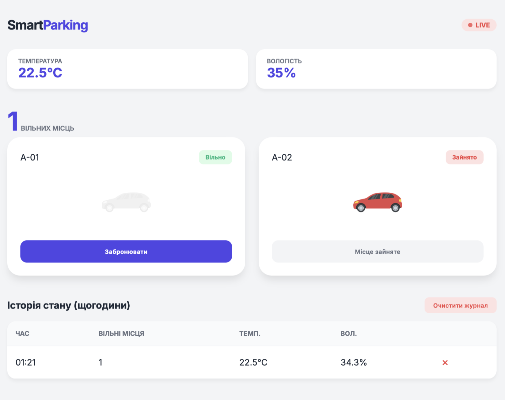

# Smart Parking System (Розумна парковка)

Курсовий проєкт, спрямований на створення прототипу системи розумної парковки з веб-інтерфейсом та мікроконтролерною частиною.
Детальніше можна подивитись у файлі [КурсоваМК.pdf](КурсоваМК.pdf)

## Демонстрація роботи

